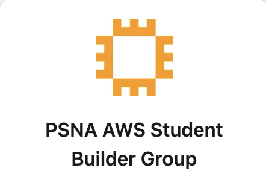
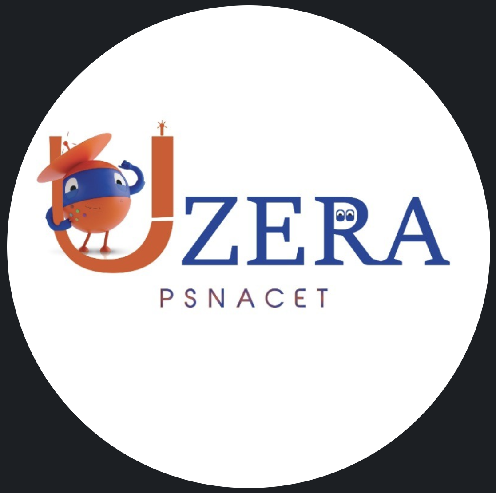

   
  <strong>
    IDEAS
     → 
    EXPERIMENTS
     → 
    INTELLIGENCE
     → 
    IMPACT
  </strong>
    

  
    <strong>Building technology with curiosity, engineering with purpose.</strong>
  

    

  
  
  
  

 

<table width="100%" cellpadding="8" cellspacing="0">
<tr>

<td width="62%" valign="top">

<h3>
◆ Beyond the Code
</h3>

I’m interested in the space where **technology becomes a solution** — where an idea has to move beyond a concept and become something people can actually use.

I enjoy breaking down complex problems, exploring different approaches, and building systems that combine **data, intelligence, automation, and software**.

What excites me most is the process:

 

<strong>
QUESTION
&nbsp;→&nbsp;
EXPLORE
&nbsp;→&nbsp;
BUILD
&nbsp;→&nbsp;
REFINE
</strong>

</td>

<td width="38%" valign="top">

<h3>
◆ My Playground
</h3>

<strong>01</strong>
&nbsp; Generative AI

<strong>02</strong>
&nbsp; Machine Learning

<strong>03</strong>
&nbsp; AI Agents

<strong>04</strong>
&nbsp; RAG Systems

<strong>05</strong>
&nbsp; AI Security

<strong>06</strong>
&nbsp; Intelligent Applications

</td>

</tr>
</table>

 

  <strong>
    CURIOUS ENOUGH TO EXPLORE.
     BOLD ENOUGH TO BUILD.
     HUMBLE ENOUGH TO KEEP LEARNING.
  </strong>

  
    <i>Not just writing code — understanding why it should exist.</i>
  

## Artificial Intelligence & Machine Learning Engineer

My work in AI and Machine Learning focuses on applying intelligent techniques to practical engineering problems. At Appin Technologies, I built an automated job intelligence pipeline and developed an NLP engine using Sentence Transformers to extract technical skills and generate personalized learning recommendations.

At Gradtwin, I developed an NLP security pipeline using Sentence Transformers and Scikit-learn to detect prompt injection and jailbreak attacks. I also built a Flask inference API with confidence scoring for secure LLM prompt validation with inference under 100 ms.

I'm particularly interested in NLP, Generative AI, Retrieval-Augmented Generation, intelligent agents, semantic similarity, and AI security.

## Technical Achievements

I was a finalist at Smart India Hackathon 2024 and achieved Top 5 at MEDHA National Hackathon 2026. I was also recognized as Techie of the Year at PSNACET in 2024.

I have solved 400+ problems on LeetCode and earned a Silver Badge in Java on HackerRank.

These experiences have strengthened my problem-solving ability, technical depth, teamwork, and ability to perform under challenging constraints.

## Technical Leadership

<table width="100%" cellpadding="0" cellspacing="0">
<tr>

<td align="center" width="50%" valign="top">

 

<strong>CLOUD CHAMP</strong>

 

PSNA AWS Student Builder Group

</td>

<td align="center" width="50%" valign="top">

 

<strong>TECHNICAL LEAD</strong>

 

UiPath Students Club

</td>

</tr>
</table>

## Tech Stack

I work with:

I also work with:

`Scikit-learn` · `NumPy` · `Pandas` · `Transformers` · `LangChain` · `RAG` · `Prompt Engineering` · `AI Agents` · `Power BI`

## Certifications

<table>
<tr>

<td align="center" width="25%">

 

<strong>AWS Certified</strong> 
Data Engineer – Associate

</td>

<td align="center" width="25%">

 

<strong>AWS Certified</strong> 
Cloud Practitioner

</td>

<td align="center" width="25%">

 

<strong>Oracle Cloud</strong> 
OCI 2024 Generative AI Professional

</td>

<td align="center" width="25%">

 

<strong>Google</strong> 
Cybersecurity Certificate

</td>

</tr>
</table>

---

## Social Links

&nbsp;
&nbsp;
&nbsp;
&nbsp;
&nbsp;
&nbsp;
&nbsp;

## Software I Use

## Currently

I'm continuously strengthening my software engineering fundamentals while exploring AI/ML, Generative AI, backend systems, system design, and intelligent applications.

I'm looking for opportunities where I can work on meaningful engineering problems, learn from strong teams, contribute technically, and grow into a well-rounded Software Engineer.

## Let's Connect

If you're working on an interesting engineering problem, building something ambitious, or looking for someone who enjoys learning by building, I'd be glad to connect.

